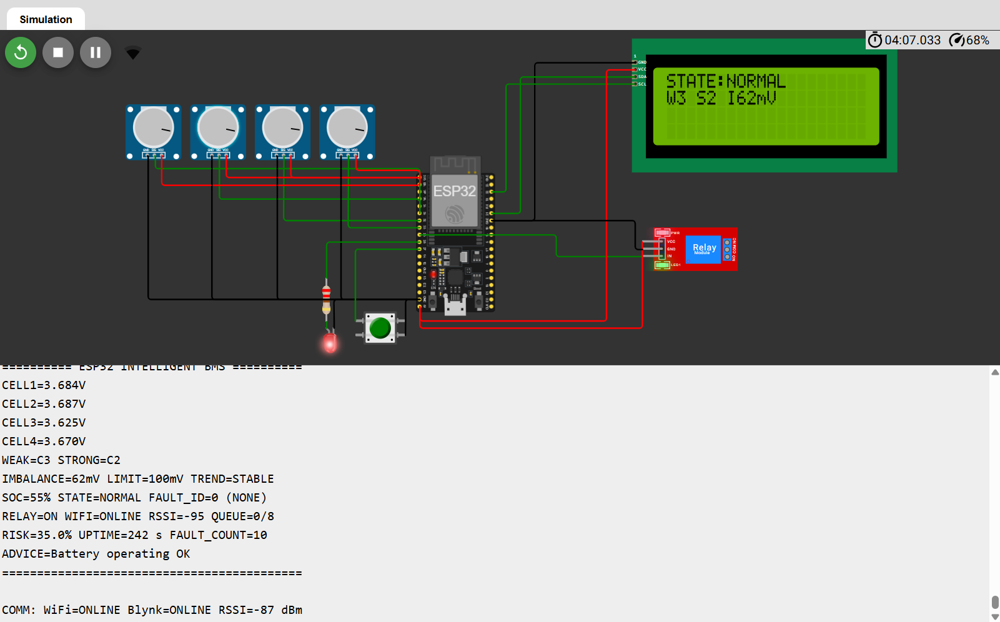
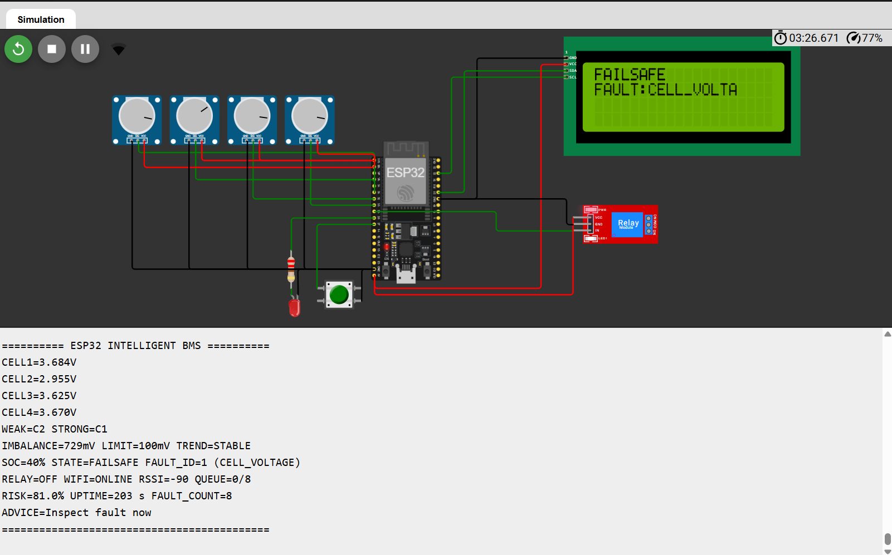
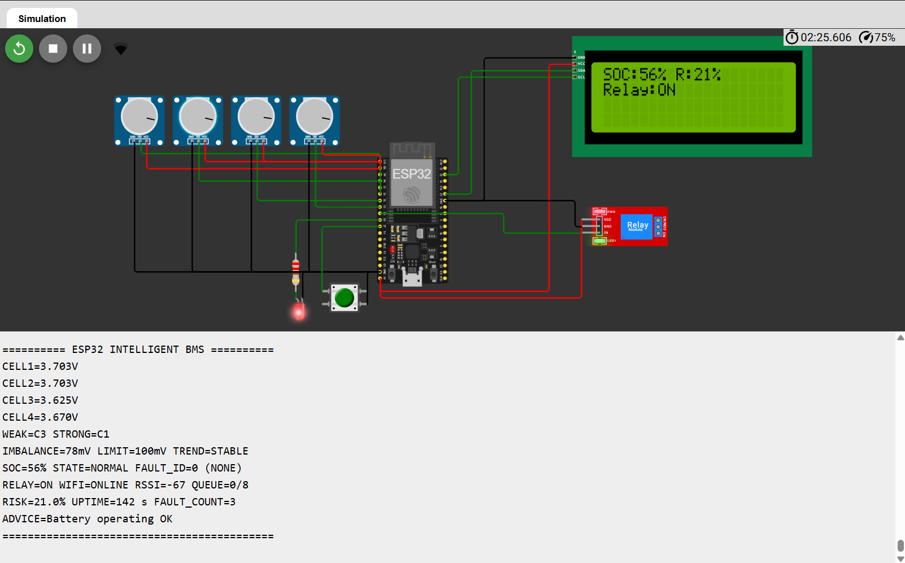
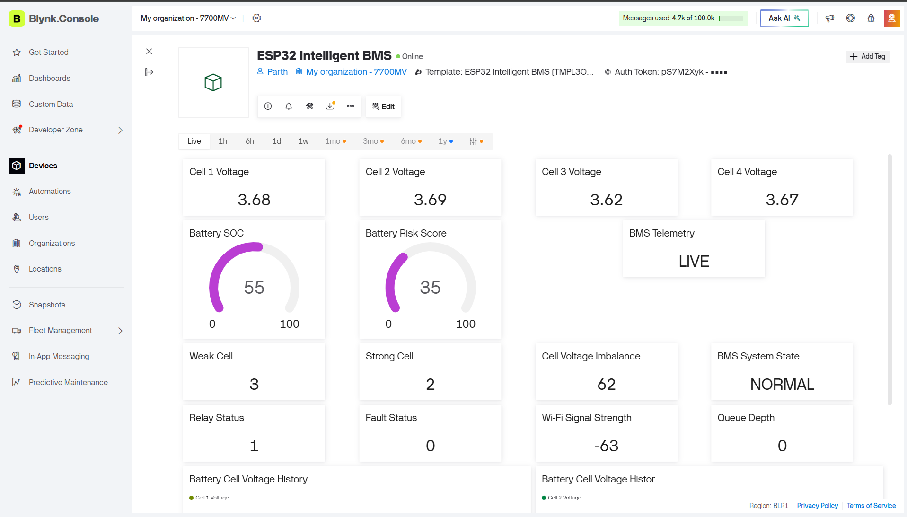
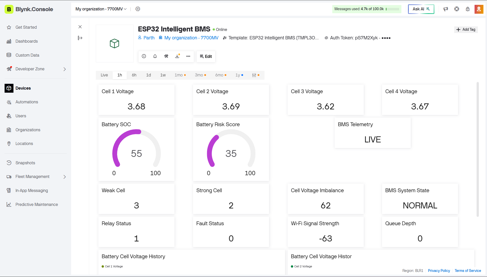
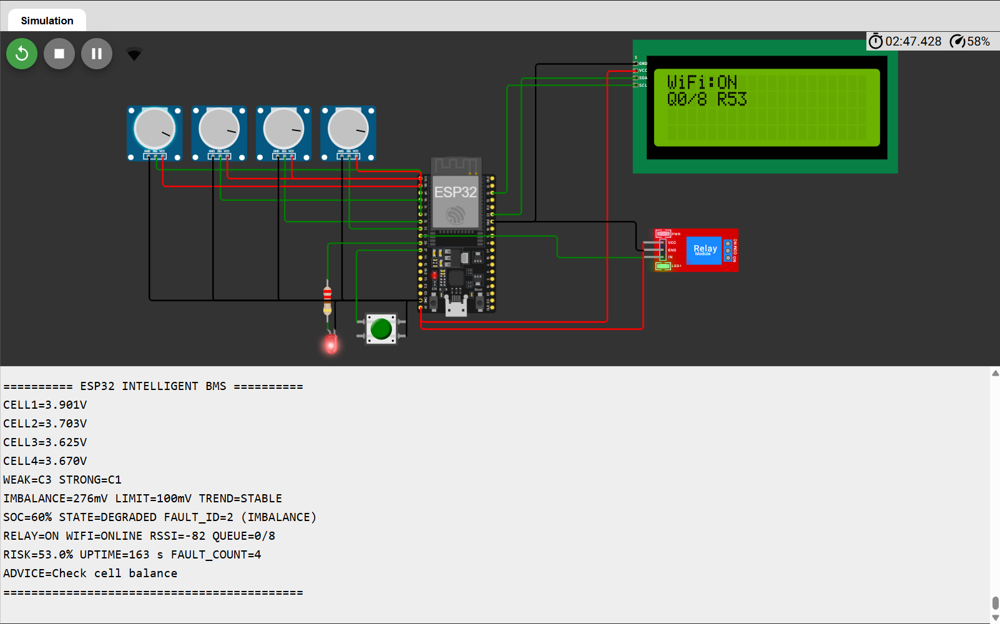

<div align="center">

# ESP32 Intelligent Battery Management System

### A Simulation-Based Embedded BMS with Fault Detection, Protection Logic and IoT Monitoring

<p>
  
  
  
  
</p>

<p>
  <strong>Embedded Systems | Battery Monitoring | Fault Management | IoT Telemetry</strong>
</p>

</div>

---

## Table of Contents

- [Project Overview](#project-overview)
- [Problem Statement](#problem-statement)
- [Project Objectives](#project-objectives)
- [Key Features](#key-features)
- [System Architecture](#system-architecture)
- [Hardware Requirements](#hardware-requirements)
- [Software and Tools](#software-and-tools)
- [Circuit Connections](#circuit-connections)
- [Working Principle](#working-principle)
- [Fault Management](#fault-management)
- [IoT Monitoring with Blynk](#iot-monitoring-with-blynk)
- [Project Screenshots](#project-screenshots)
- [How to Run the Project](#how-to-run-the-project)
- [Testing and Validation](#testing-and-validation)
- [Current Limitations](#current-limitations)
- [Future Improvements](#future-improvements)
- [Learning Outcomes](#learning-outcomes)
- [Repository Structure](#repository-structure)
- [Author](#author)

---

## Project Overview

The **ESP32 Intelligent Battery Management System (BMS)** is an embedded-systems project designed to demonstrate battery-cell voltage monitoring, voltage-imbalance analysis, fault-state management, and IoT-based monitoring.

The system uses an ESP32 microcontroller to process four simulated cell-voltage inputs. Four potentiometers represent the individual battery cells, allowing their readings to be adjusted independently during testing.

The firmware analyses the cell readings, identifies the weakest and strongest cells, calculates voltage imbalance, estimates State of Charge (SoC), and evaluates a demonstration risk score.

A 16×2 I²C LCD provides local status information, while a relay output and LED demonstrate protection actions. Wi-Fi connectivity and the Blynk IoT platform provide remote monitoring and historical voltage visualisation.

The project is developed and tested in the Wokwi simulation environment.

**Try the simulation:** [Open the ESP32 Intelligent BMS on Wokwi](https://wokwi.com/projects/477481844956329985).

> **Project scope:** This is an educational BMS prototype. Its simulation results demonstrate firmware behaviour and interface functionality; they do not establish the safety or accuracy of a real battery pack.

---

## Problem Statement

Battery packs consist of multiple cells whose voltages may differ during charging and discharging.

If the voltage difference between cells becomes excessive, the system should identify the imbalance and make the condition visible to the operator. Abnormal readings may also require a protective response.

A monitoring system should therefore provide:

- Individual cell-voltage monitoring.
- Identification of the weakest and strongest cells.
- Detection and indication of abnormal operating conditions.
- Structured fault-state handling.
- Local status information.
- Remote monitoring and historical data visualisation.

This project demonstrates these functions using an ESP32, simulated cell inputs, an LCD, protection indicators, and Blynk IoT.

---

## Project Objectives

1. Monitor four independently adjustable simulated cell-voltage inputs.
2. Calculate the minimum and maximum cell voltages.
3. Identify the weakest and strongest cells.
4. Calculate the voltage difference between the highest and lowest cell readings.
5. Observe changes in voltage imbalance over successive measurements.
6. Demonstrate SoC estimation and a risk indicator.
7. Implement structured protection states and recovery behaviour.
8. Display battery information using a 16×2 I²C LCD.
9. Demonstrate relay and LED control based on protection logic.
10. Transmit selected monitoring data to a Blynk dashboard.
11. Observe system behaviour during Wi-Fi disconnection and reconnection.

---

## Key Features

| Feature | Description |
|---|---|
| Cell Voltage Monitoring | Reads four simulated cell-voltage inputs |
| Weakest Cell Identification | Identifies the cell with the minimum measured voltage |
| Strongest Cell Identification | Identifies the cell with the maximum measured voltage |
| Voltage Imbalance | Calculates the difference between the highest and lowest cell voltages |
| Imbalance Trend | Observes whether the imbalance is increasing, decreasing, or stable |
| SoC Estimation | Calculates a demonstration State of Charge estimate |
| Risk Assessment | Provides a demonstration risk indicator |
| Fault-State Management | Demonstrates NORMAL, DEGRADED, FAILSAFE and SHUTDOWN states |
| Protection Output | Controls a relay output according to protection logic |
| Status Indication | Uses an LED to indicate system conditions |
| LCD Interface | Displays system information on a 16×2 I²C LCD |
| IoT Connectivity | Uses Wi-Fi and Blynk for remote monitoring |
| Historical Visualisation | Displays voltage data through Blynk historical graphs |
| Communication Monitoring | Demonstrates behaviour during Wi-Fi disconnection |

---

## System Architecture

The project follows a layered architecture to separate sensing, analysis, protection, display, and communication functions.

```text
       FOUR SIMULATED CELL INPUTS
          Potentiometers × 4
                  |
                  v
          +---------------+
          |  ESP32 ADC    |
          | Voltage Input |
          +---------------+
                  |
                  v
          +---------------+
          | Data Analysis |
          |               |
          | Weakest Cell  |
          | Strongest Cell|
          | Imbalance     |
          | SoC Estimate  |
          | Risk Indicator|
          +---------------+
                  |
                  v
          +---------------+
          | Fault-State   |
          | Management    |
          |               |
          | NORMAL        |
          | DEGRADED      |
          | FAILSAFE      |
          | SHUTDOWN      |
          +---------------+
                  |
          +-------+-------+
          |               |
          v               v
   +-------------+  +-------------+
   | LCD Display |  | Relay / LED |
   +-------------+  +-------------+
          |
          v
   +------------------+
   | Wi-Fi and Blynk  |
   | IoT Monitoring   |
   +------------------+
          |
          v
   +------------------+
   | Live Values and  |
   | Historical Graphs|
   +------------------+
```

### Architecture Layers

| Layer | Responsibility |
|---|---|
| Sensing Layer | Reads the four simulated cell inputs |
| Analysis Layer | Calculates cell statistics and battery indicators |
| Protection Layer | Evaluates conditions and manages protection states |
| Output Layer | Controls the relay output and LED |
| Local Interface | Displays information on the LCD |
| Communication Layer | Maintains Wi-Fi/Blynk connectivity and telemetry |
| Dashboard Layer | Presents current measurements and historical graphs |

---

## Hardware Requirements

| Component | Quantity | Purpose |
|---|---:|---|
| ESP32 DevKit V1 | 1 | Main microcontroller |
| Potentiometers | 4 | Simulated cell-voltage inputs |
| 16×2 I²C LCD | 1 | Local monitoring interface |
| Single-Channel Relay Module | 1 | Demonstration protection output |
| LED | 1 | Visual status indication |
| Current-Limiting Resistor | 1 | LED current limiting |
| Push Button | 1 | Manual state interaction |
| Jumper Wires | As required | Circuit connections |

**Note:** The potentiometers simulate cell-voltage inputs. They are not actual battery cells or a substitute for a properly designed battery measurement circuit.

---

## Software and Tools

| Tool | Purpose |
|---|---|
| Arduino IDE | Firmware development |
| Wokwi | Circuit simulation and functional testing |
| Blynk IoT | Remote monitoring and dashboard visualisation |
| C++ / Arduino Framework | Embedded firmware |
| Git and GitHub | Source-code management and documentation |

---

## Circuit Connections

The following table documents the intended ESP32 pin mapping for the simulation.

| Component | ESP32 Pin | Function |
|---|---|---|
| Cell Input 1 | GPIO 34 | Analog input |
| Cell Input 2 | GPIO 35 | Analog input |
| Cell Input 3 | GPIO 32 | Analog input |
| Cell Input 4 | GPIO 33 | Analog input |
| I²C LCD SDA | GPIO 21 | I²C data |
| I²C LCD SCL | GPIO 22 | I²C clock |
| Relay Module | GPIO 25 | Protection output |
| LED | GPIO 26 | Status indication |
| Push Button | GPIO 27 | Manual input |

**Important:** Verify the connections against the current Wokwi circuit and firmware before building the hardware. GPIO assignments, relay polarity, and peripheral wiring must match the actual implementation.

---

## Working Principle

### 1. Cell Voltage Acquisition

Four potentiometers provide independently adjustable analog inputs to the ESP32.

The firmware reads these inputs and converts the ADC readings into simulated cell-voltage values.

### 2. Cell Data Analysis

The firmware compares the cell readings and identifies:

- Minimum cell voltage.
- Maximum cell voltage.
- Weakest cell.
- Strongest cell.
- Voltage imbalance.

The voltage imbalance is calculated as:

```text
Voltage Imbalance = Maximum Cell Voltage - Minimum Cell Voltage
```

### 3. Imbalance Trend Analysis

Successive measurements are compared to observe whether the voltage imbalance is increasing, decreasing, or remaining approximately stable.

This information helps demonstrate how changing cell-voltage differences can be monitored over time.

### 4. Battery Indicators

The system calculates a demonstration State of Charge (SoC) estimate and a risk indicator from the implemented firmware logic.

These values are intended for educational demonstration and should not be treated as calibrated battery diagnostics.

### 5. Fault Evaluation

The firmware evaluates monitored conditions and updates the system state according to its protection logic.

The resulting state is reflected through the available outputs and monitoring interfaces.

### 6. Local and Remote Monitoring

The LCD presents local system information. Wi-Fi and Blynk provide remote telemetry and dashboard visualisation.

The system also demonstrates communication-disconnection behaviour.

---

## Fault Management

The project demonstrates a structured four-state fault-management model.

| State | General Meaning |
|---|---|
| NORMAL | No condition requiring a higher protection state has been detected |
| DEGRADED | An abnormal or degraded operating condition has been identified |
| FAILSAFE | The protection logic has entered a failsafe condition |
| SHUTDOWN | The system has entered its shutdown state |

The exact transition conditions depend on the thresholds and rules implemented in the firmware.

### Protection Features

- Evaluation of monitored cell conditions.
- State-based fault handling.
- Relay output control.
- LED status indication.
- Recovery behaviour when configured conditions are satisfied.
- Local status visibility through the LCD.

**Safety note:** The relay output demonstrates protection-control logic in simulation. It does not prove that a real battery pack can be safely disconnected under fault conditions.

---

## IoT Monitoring with Blynk

Blynk is used to demonstrate remote monitoring of the simulated battery system.

The dashboard can present the telemetry configured in the firmware, including selected cell measurements, cell statistics, system state, and other implemented indicators.

### Dashboard Capabilities

- Remote visibility of monitored cell voltages.
- Display of selected battery indicators.
- System-state monitoring.
- Live telemetry visualisation.
- Historical voltage graphs.
- Observation of connectivity-related behaviour.

The exact dashboard values depend on the configured Blynk datastreams and the data published by the firmware.

---

## Project Screenshots

The following screenshots demonstrate selected simulation, fault-handling, local-display, and IoT-monitoring results.

### 1. Normal Battery Operation

Shows the system during normal simulated operation.



---

### 2. Cell Voltage Imbalance

Shows the system when the simulated cell inputs have different voltage readings.


---

### 3. Fault Detection and FAILSAFE

Shows an example of fault detection and the failsafe state.



---

### 4. Recovery to Normal State

Shows the demonstrated recovery from a fault condition to normal operation.


---

### 5. LCD Display

Shows the local LCD interface used to display system information.



---

### 6. Blynk Live Monitoring Dashboard

Shows the Blynk dashboard used for remote system monitoring.



---

### 7. Blynk Dashboard Overview

Shows the dashboard overview and the monitoring indicators available in the saved screenshot.



---

### 8. Wi-Fi Disconnection Test

Shows the saved evidence associated with Wi-Fi disconnection testing.



---

## How to Run the Project

### Step 1: Open the Repository

Clone or download this repository from GitHub.

```bash
git clone https://github.com/khairnarparth291-crypto/ESP32-Intelligent-Battery-Management-System.git
```

### Step 2: Open the Firmware

Locate the main Arduino firmware file:

```text
ESP32_Intelligent_BMS.ino
```

Open it using the Arduino IDE or the appropriate Wokwi project setup.

### Step 3: Configure the Environment

Verify that the required libraries are installed and that the ESP32 board configuration is correct.

If the firmware uses Blynk, configure the required template details, device credentials, and datastreams.

### Step 4: Configure Credentials

Provide the Wi-Fi and Blynk credentials required by your local setup.

**Never publish real Wi-Fi passwords, Blynk authentication tokens, or other private credentials in a public repository.**

### Step 5: Start the Simulation

Open the Wokwi circuit and start the simulation.

Adjust the four potentiometers to change the simulated cell-voltage inputs.

### Step 6: Observe System Behaviour

Observe the serial output, LCD, relay/LED indications, and Blynk dashboard.

Test normal operation, voltage imbalance, fault handling, recovery, and Wi-Fi disconnection scenarios supported by the current implementation.

---

## Testing and Validation

The project is intended to demonstrate the firmware's monitoring and supervisory behaviour in simulation.

| Test Scenario | What to Observe |
|---|---|
| Normal Operation | Cell readings and system state |
| Cell Voltage Variation | Changes in individual cell measurements |
| Voltage Imbalance | Difference between the maximum and minimum cell voltages |
| Weakest and Strongest Cell | Identification of the minimum and maximum readings |
| Fault Condition | State changes and protection indications |
| Recovery | Behaviour after the fault condition is removed |
| LCD Monitoring | Local display updates |
| Blynk Monitoring | Remote telemetry and dashboard updates |
| Wi-Fi Disconnection | Communication status and offline behaviour |

The results should be interpreted as simulation evidence. They do not establish measurement accuracy, hardware reliability, or real-battery protection performance.

---

## Current Limitations

The current implementation has the following important limitations:

1. **Simulated cell inputs:** Four potentiometers represent cell-voltage inputs. Actual battery cells are not measured by this simulation setup.
2. **Four-cell demonstration:** The documented setup demonstrates four simulated cells.
3. **No relay-contact feedback:** The firmware controls a relay output but does not verify the actual state of relay contacts.
4. **Limited fault validation:** Only the fault scenarios exercised and verified in the current implementation should be considered demonstrated.
5. **Simulation-specific thresholds:** Protection thresholds and analytical values are intended for the demonstration and require engineering validation for real hardware.
6. **Connectivity dependency:** Remote monitoring depends on the Wi-Fi connection and Blynk service.
7. **Offline data limitations:** Any offline telemetry buffering implemented in RAM is temporary and may be lost after a reset or power loss.
8. **No safety certification:** The prototype is not a certified battery protection system and should not be used to protect a real battery pack.

---

## Future Improvements

Potential future development includes:

- Integration of a dedicated battery-monitoring IC.
- Accurate voltage sensing with suitable protection and calibration.
- Current sensing and temperature monitoring.
- State of Health (SoH) estimation using validated methods.
- Improved SoC estimation using battery-specific models.
- Cell balancing hardware and control algorithms.
- Hardware verification of relay and contactor operation.
- Persistent telemetry storage and improved offline recovery.
- Expanded fault injection and automated regression tests.
- Validation using a suitable laboratory test setup.
- Extension to additional cells using appropriate measurement hardware.
- Improved fault logging and diagnostic reporting.

Any expansion beyond four cells requires suitable additional sensing hardware or multiplexing, appropriate pin mapping, and firmware validation. Changing a cell-count constant alone does not provide additional physical measurement channels.

---

## Learning Outcomes

This project provides practical experience with:

- ESP32 microcontroller programming.
- Analog input acquisition and voltage conversion.
- Embedded C++ development.
- Battery-monitoring concepts.
- Voltage imbalance calculations.
- State-machine-based fault management.
- Non-blocking periodic firmware tasks.
- LCD interfacing using I²C.
- Relay and LED control.
- Wi-Fi communication and IoT telemetry.
- Blynk dashboard configuration.
- Simulation-based functional testing.
- GitHub version control and technical documentation.

---

## Repository Structure

The repository contains the project firmware and supporting documentation and simulation evidence.

```text
ESP32-Intelligent-Battery-Management-System/
│
├── README.md
├── ESP32_Intelligent_BMS.ino
│
├── docs/
│   └── BMS_Assumptions_Document.md
│
└── screenshots/
    └── Additional project evidence, if organised here
```

**Note:** This is a logical overview of the main project files. The actual folder structure may contain additional files and screenshots.

---

## Author

**Electronics and Telecommunication Engineering Student**

Interested in embedded systems, microcontrollers, IoT, battery monitoring, and hardware-software integration.

### Project Links

- **GitHub Repository:** [ESP32 Intelligent Battery Management System](https://github.com/khairnarparth291-crypto/ESP32-Intelligent-Battery-Management-System)
- **Wokwi Simulation:** [Open the Interactive ESP32 BMS Simulation](https://wokwi.com/projects/477481844956329985)
- **Main Firmware:** [`ESP32_Intelligent_BMS.ino`](./ESP32_Intelligent_BMS.ino)
- **Assumptions Document:** [`BMS_Assumptions_Document.md`](./docs/BMS_Assumptions_Document.md)
- **Bug Log and Verification Notes:** [`BMS_Bug_Log.md`](./docs/BMS_Bug_Log.md)
- **Screenshot Documentation:** [`screenshots/README.md`](./screenshots/README.md)

> **Simulation note:** Open the Wokwi link to view the circuit and run the simulation. Blynk telemetry may require your own Wi-Fi configuration and private device credentials; do not publish those credentials in this repository.

---

## Disclaimer

This project is an educational and simulation-based prototype developed to demonstrate embedded battery-monitoring concepts, fault-state logic, and IoT visualisation.

It has not been established as a certified or safety-validated battery management system. The simulated inputs, estimated indicators, thresholds, and protection outputs must not be relied upon for real battery-pack safety.

Real-world deployment requires suitable battery-monitoring hardware, calibrated measurements, independent protection mechanisms, hardware-level validation, and appropriate engineering and safety review.

---

<div align="center">

**Built to explore Embedded Systems, Battery Monitoring, Fault Management, and IoT.**

</div>
